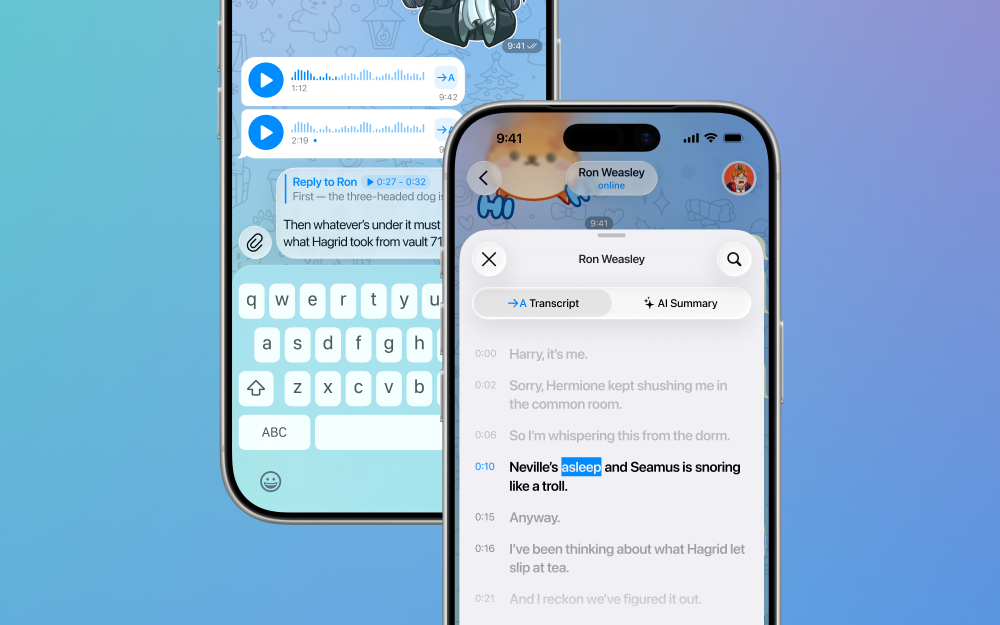
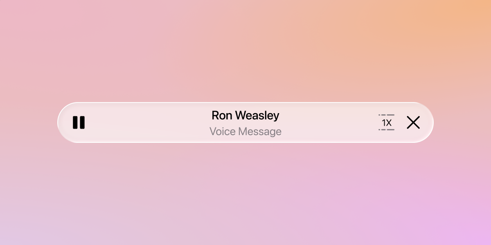
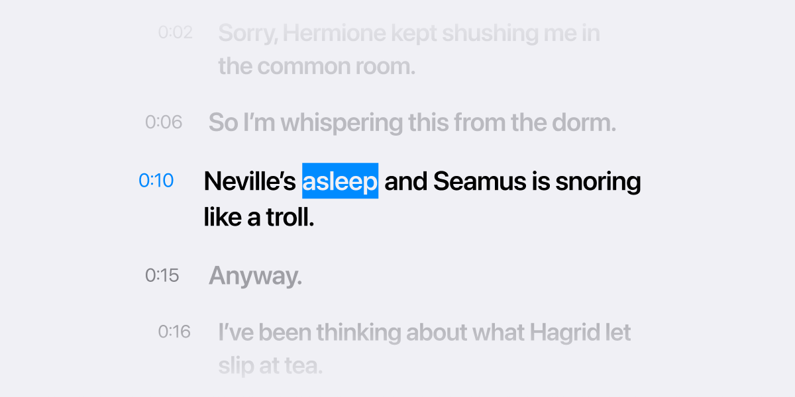
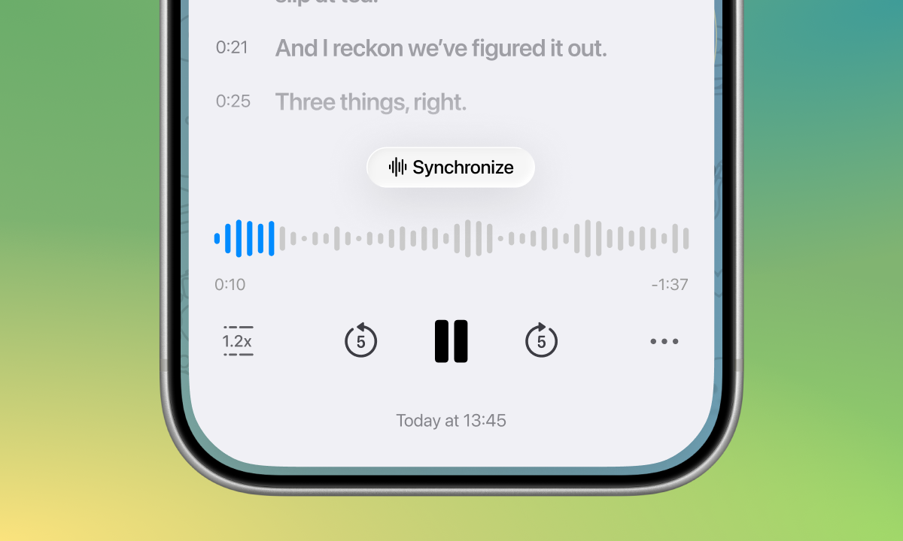
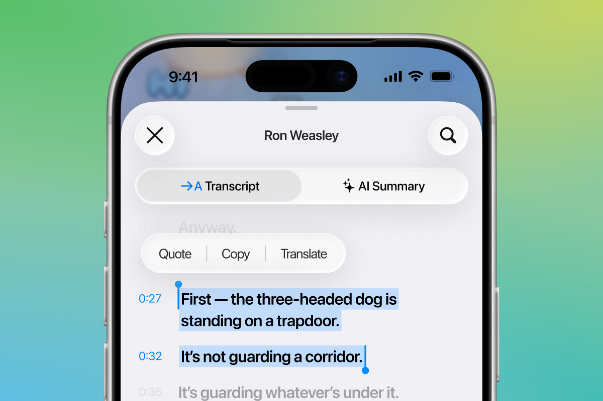
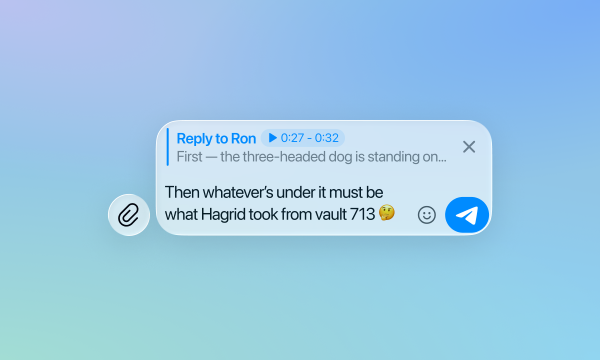
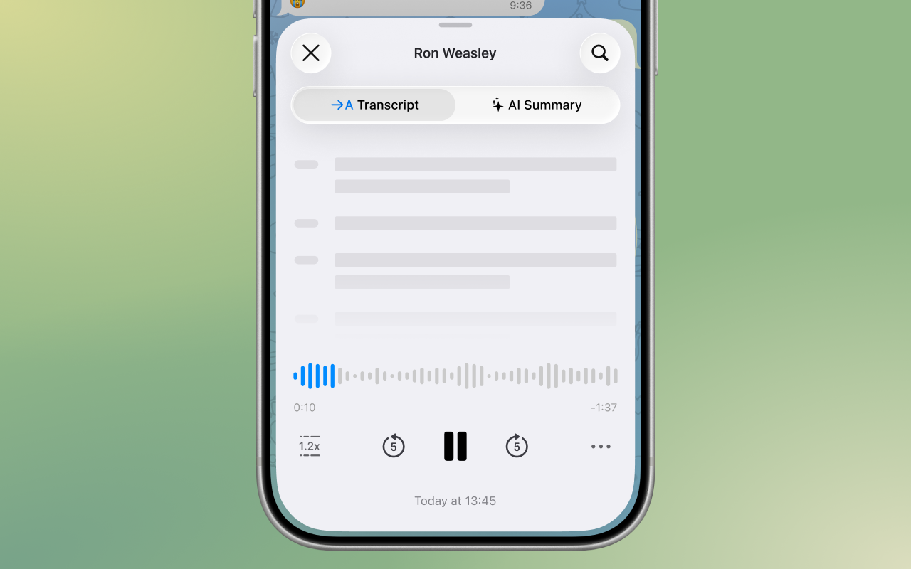
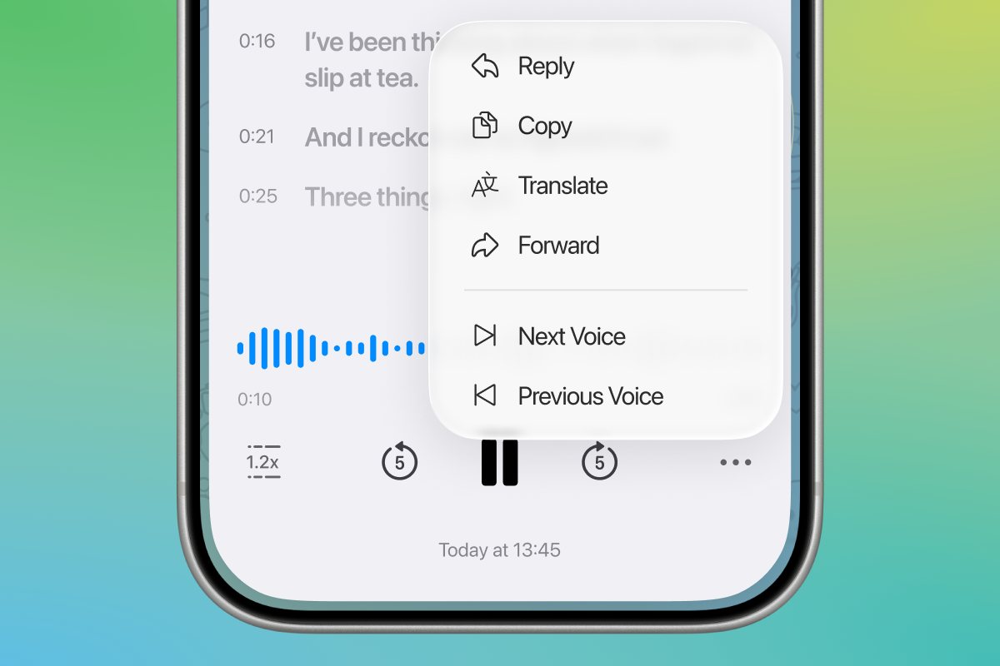
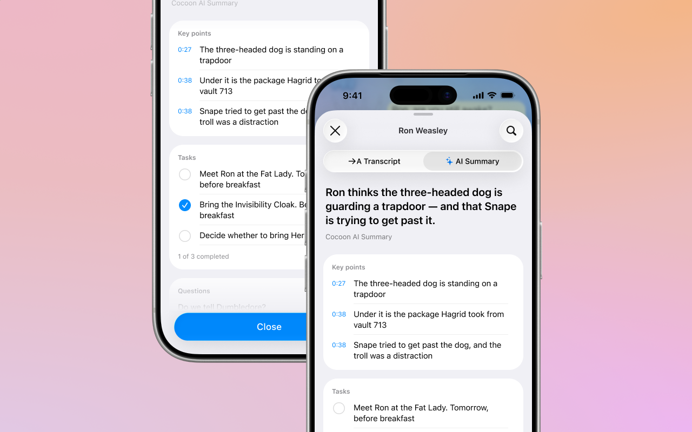

# Voice Message Transcript and AI Summary

> **Build-validation update (2026-10-21): full Debug simulator build passed.** `//Telegram:Telegram` compiled/type-checked the feature module and linked the whole app under Xcode 26.6 in an isolated Bazel output base; no feature compile fixes were needed. The freshly installed app reached **Telegram / Start Messaging** onboarding and remained alive at the 20-second check. This is startup-only evidence, not login or feature UI verification. Current checks: **23 XCTest passes, 480 summary + 59 alignment smoke passes, 18 Node fixture passes and 1 skipped real-host audit**. See the [build validation record](docs/BUILD_VALIDATION.md).

A redesigned way to work with voice messages in Telegram for iOS: a sheet where the audio and its text move together, with a summary of the key points on a second tab.

> **Release status: integration candidate, not a production-certified app.** Local hardening adds timestamped tasks, optional measured/strictly matched timing, safe quote sharing, strict summary parsing, lossless bounded chunking, and automated core tests. The full pinned host and all 13 submodules are available. **Debug `sim_arm64` compilation and onboarding startup passed** with a dummy-credential configuration; Release, physical-device and live-feature verification remain open. See [host integration](docs/HOST_INTEGRATION.md) and [production readiness](docs/PRODUCTION_READINESS.md).

## Implementation comparison: upstream vs. this workspace

**Historical feature baseline:** upstream commit `abce7ccf9537b4074be346e852e2303c50b649fa`, fetched from [patsoooo/telegram-voice-transcription](https://github.com/patsoooo/telegram-voice-transcription/commit/abce7ccf9537b4074be346e852e2303c50b649fa). **Current:** local workspace changes described below; these are not claims that upstream has merged or released them. The separate **official host baseline** is `f1dd7a2dbd02cbbf513e75d5695d8d36d1cf5838` from TelegramMessenger/Telegram-iOS, recorded in the [host manifest](Integration/host-manifest.json). The [combined host patch](Integration/telegram-ios-f1dd7a2.patch) supersedes the [historical integration patch](changes.patch) for this pin; do not apply both.

**Status key:** **Implemented** means code exists in this module or, where explicitly marked, the combined host patch. **Core verified** means portable logic has local executable checks. **Partial** means the original requirement still has a gap. **Host validation required** means runtime UIKit/Telegram behavior remains untested: full Debug simulator compilation/type-checking has passed. No row certifies production readiness.

### Missing or partial features addressed

| Feature / earlier gap | Earlier implementation | Current implementation and precise boundaries | Status | Code reference / symbols |
| --- | --- | --- | --- | --- |
| Task timestamps | Tasks held only text and completion state; no audio position. | `VoiceSummary.Task.time: Double?` stores the source position. New live AI tasks require a timestamp; old stored tasks still decode with `nil` rather than an invented time. | Implemented; core verified | [Summary model and parser](VoiceTranscriptScreen/Sources/VoiceSummaryCore.swift): `VoiceSummary.Task`, `parseVoiceSummary(_:rejectMalformedItems:)` |
| Tap a task's time to seek | Task rows only toggled checkboxes. | A separate 44-point-high timestamp button seeks without toggling completion; the checkbox/text still toggles completion. | Implemented; host validation required | [Summary UI](VoiceTranscriptScreen/Sources/VoiceTranscriptScreen.swift): `VoiceSummaryView.buildContent(_:)`, `addCard(...)` |
| Preserve task times in exported text | Task Copy/Share text contained completion marks and task text only. | Task Copy and whole-summary Share include completion marks and available timestamps. Legacy untimed tasks remain untimed. | Implemented; host validation required | [Summary export](VoiceTranscriptScreen/Sources/VoiceTranscriptScreen.swift): `shareableText`, task-card `copyText` closure |
| Access measured word timing | A measured Apple Speech provider existed, but was not selectable through this sheet; default timing was estimated. | Player menu explicitly selects speech recognition in the device language or returns to estimated server timing. Recognition can change the words; its initializer accepts `localeIdentifier`. No silent estimated fallback on recognition failure. | Implemented option; exact timing not guaranteed; host validation required | [Provider switch](VoiceTranscriptScreen/Sources/VoiceTranscriptScreen.swift): `presentMoreMenu(sourceView:)`; [speech provider](VoiceTranscriptScreen/Sources/VoiceTranscriptRecognition.swift): `RecognizedVoiceTranscriptProvider` |
| Preserve server words with measured timing | No selectable strict lexical matching path. | **Match server words to speech timing (strict)** selects `AlignedVoiceTranscriptProvider`. Transfers recognition timestamps only after exact normalized, positional lexical agreement for every token; preserves server word text, refuses insertions/deletions, mismatches and invalid timing, and never guesses or returns partial alignment. | Implemented; **59 current portable alignment checks passed**; no acoustic accuracy measurement or runtime host validation | [Alignment core](VoiceTranscriptScreen/Sources/VoiceTranscriptAlignmentCore.swift): `alignVoiceTranscriptWords`; [provider](VoiceTranscriptScreen/Sources/VoiceTranscriptAlignment.swift) |
| Understand timing accuracy | Timing limitations were documented, but the transcript model did not identify the source. | Transcript carries `.estimated`, `.measured`, `.aligned`, or `.demo`; player menu describes the source. `.aligned` means lexical agreement with transferred measured timestamps, not ground-truth accuracy or forced alignment. | Implemented; host validation required | [Transcript model](VoiceTranscriptScreen/Sources/VoiceTranscriptData.swift): `VoiceTranscriptTimingProvenance`; [player menu](VoiceTranscriptScreen/Sources/VoiceTranscriptScreen.swift): `presentMoreMenu(sourceView:)` |
| Recipient-visible timestamped quotations | Quote/Reply showed timestamp and selected words only in the sender's composer; recipients received a normal voice-message reply. | Combined host patch prepends an **editable timestamped blockquote in the message body** plus an ordinary native reply to the voice message. Preserves existing `ChatInputContent` blocks and shifts the selection; only normal Send transmits it. Separate Share still offers timestamped ordinary text with confirmation. **Not MTProto `quote_text`**, server-verified quote metadata, or a guaranteed clickable audio time. | Implemented in host patch; send/recipient/device validation required | [Combined host patch](Integration/telegram-ios-f1dd7a2.patch): `voiceReplyInputState`, `setupReplyMessage`; [Share](VoiceTranscriptScreen/Sources/VoiceTranscriptScreen.swift): `presentShareQuote(text:timeText:)` |
| Open directly from a voice bubble | Historical integration opened from the playback header only. | Combined host patch routes the voice bubble's transcription button to the transcript sheet; playback-header access is retained. | Implemented in host patch; not device verified | [Combined host patch](Integration/telegram-ios-f1dd7a2.patch): `ChatMessageInteractiveFileNode` transcription-button action |
| Summary failure safety | Failed AI requests could show seeded random sample content unrelated to the recording. | Both real providers use the server summary path; failures return `.unavailable`. No sample-content fallback. Explicit demo providers still exist as fixtures. | Implemented; core placeholder rejection verified | [Server provider](VoiceTranscriptScreen/Sources/ServerVoiceTranscript.swift): `makeSummary(...)`; [speech provider](VoiceTranscriptScreen/Sources/VoiceTranscriptRecognition.swift): `summary(context:messageId:transcript:)` |
| Missing AI categories | Missing key points could be filled with randomly chosen transcript lines. | Live summary path no longer calls random completion; absent categories remain absent. This avoids disguising arbitrary transcript excerpts as AI-selected key points. | Implemented | [Server pipeline](VoiceTranscriptScreen/Sources/ServerVoiceTranscript.swift): `makeSummary(...)` |

### Reliability, privacy and test improvements added

| Improvement | Earlier behavior / risk | Current behavior | Status | Code reference / symbols |
| --- | --- | --- | --- | --- |
| Lossless long-transcript chunking | Lines exceeding the prompt budget were truncated; transcripts needing more than six chunks were sampled. | Preserves all source Unicode scalars across chunks; continuation chunks repeat the source line timestamp. Each complete prompt is at most **900 UTF-16 units**. More than **128 parts** returns no prompts and makes the summary unavailable, rather than silently dropping content. This guarantees input coverage within the bound, not that the AI mentions every fact. | Implemented; core verified | [Chunking](VoiceTranscriptScreen/Sources/VoiceSummaryCore.swift): `voiceSummaryPrompts(lines:languageName:)` |
| No silent partial-success summary | Failed chunks could be omitted while successful chunks were presented as the result. | Every part must return a usable parsed and validated result; a failed part invalidates the whole summary. | Implemented; live API validation required | [Sequential pipeline](VoiceTranscriptScreen/Sources/ServerVoiceTranscript.swift): `makeSummary(...)`, nested `accumulate(...)` |
| Bounded request concurrency and retries | Part requests were combined concurrently; a global deadline bounded the aggregate operation. | Requests run sequentially. Generic errors receive at most one retry, within a **30-second per-part** timeout. Large accepted inputs can still take many minutes; there is no single short whole-summary deadline. | Implemented; cancellation/rate-limit testing required | [Request handling](VoiceTranscriptScreen/Sources/ServerVoiceTranscript.swift): `voiceSummaryGenerate(context:prompt:)` |
| Strict AI response parsing | Some missing/invalid times became zero; unstructured output could become a headline. | Live requests use `rejectMalformedItems: true`. Invalid/missing timed items reject the response; arbitrary unlabeled prose is not accepted as a summary. Legacy parsing remains available for untimed tasks outside the strict live path. | Implemented; core verified | [Parser](VoiceTranscriptScreen/Sources/VoiceSummaryCore.swift): `voiceSummaryTime(_:)`, `parseVoiceSummary(_:rejectMalformedItems:)` |
| Source timestamp validation | Model-generated seek times were not checked against source line starts. | Rejects nonfinite, negative and unrelated times. Accepted times snap to the nearest transcript line start only within **one second**, accommodating display rounding. This does not prove semantic correctness. | Implemented; core verified | [Validation](VoiceTranscriptScreen/Sources/VoiceSummaryCore.swift): `voiceSummaryValidated(_:allowedTimes:)`; [live enforcement](VoiceTranscriptScreen/Sources/ServerVoiceTranscript.swift): `makeSummary(...)` |
| Preserve merged items | Merged summaries capped key points/tasks/questions globally; deduplication by text alone lost repeated statements at different positions. | No global item-list caps. Deduplicates by lowercase text **and source time**, retains identical text at different times, and orders timed items chronologically. Chunk-level AI item limits still apply; part headlines are joined, not silently truncated for another prompt. | Implemented; core verified | [Merge](VoiceTranscriptScreen/Sources/VoiceSummaryCore.swift): `voiceSummaryCombined(_:)` |
| AI invoked by user action | Summary generation started as soon as the transcript was ready. | Generation starts only after the user opens the Summary tab, guarded against duplicate requests in the sheet. This is not a complete consent/disclosure policy. | Implemented; host validation required | [Tab/request lifecycle](VoiceTranscriptScreen/Sources/VoiceTranscriptScreen.swift): `selectTab(_:)`, `startSummary(transcript:)`, `didRequestSummary` |
| Prompt-injection mitigation | Prompt did not explicitly distinguish transcript content from instructions. | Prompt identifies transcript text as untrusted data and tells the model not to follow its commands or invent facts. This is mitigation, not an injection-proof or hallucination-proof guarantee. | Implemented; instruction covered by core checks | [Prompt](VoiceTranscriptScreen/Sources/VoiceSummaryCore.swift): `voiceSummaryInstruction(languageName:maxItems:)` |
| Summary cache isolation and retention | Summary cache persisted text in UserDefaults and was keyed by message without an account/source identity. | Locked, **32-entry memory-only** cache uses account/message identity and exact transcript text/timing identity. Restart regenerates summaries. Old disk data is neither read nor automatically deleted. | Implemented; logout erasure/storage policy still required | [Summary cache](VoiceTranscriptScreen/Sources/ServerVoiceTranscript.swift): `VoiceSummaryCache` |
| Recognized transcript cache | Recognized words persisted in files; cache identity did not include account and locale. | Locked, **32-entry memory-only** cache scoped by account, audio file and recognition locale. Legacy files remain untouched. | Implemented; host privacy review required | [Transcript cache](VoiceTranscriptScreen/Sources/VoiceTranscriptRecognition.swift): `VoiceTranscriptCache` |
| Recognition validation and deadline | Locale guesses included English; returned word ends could be clamped; timeout covered download rather than the entire path. | Uses the chosen locale only and checks existing speech permission. Rejects malformed timing: finite values, nonnegative/monotonic starts, end not before start, end at most duration + **0.5 seconds**. A **90-second** deadline covers lookup/download/conversion/recognition. | Implemented; host/device validation required | [Speech handling](VoiceTranscriptScreen/Sources/VoiceTranscriptRecognition.swift): `validatedVoiceTranscriptWords(_:duration:)`, `transcript(context:messageId:duration:)` |
| Safe player seeks | Seek requests were sent directly to playback controls. | Rejects nonfinite values and invalid duration; clamps valid seek targets to the current media duration. | Implemented; host validation required | [Playback](VoiceTranscriptScreen/Sources/VoiceTranscriptScreen.swift): `seek(to:)` |
| Task completion account isolation | Task state key contained message identity but not the current account. | Account identity added to versioned completion keys. Task text is **still stored in UserDefaults**; protected storage and retention review are not finished. | Implemented isolation; privacy work remains | [Task state](VoiceTranscriptScreen/Sources/VoiceTranscriptScreen.swift): `tasksKey`, `loadTaskStates`, `saveTaskStates` |
| Sensitive summary logs | Debug summary logs could contain model answers and server error details. | Current server summary path no longer prints answer text, transcript contents or server error descriptions. The original host patch still needs its own logging review. | Implemented in this module; host review required | [Server requests](VoiceTranscriptScreen/Sources/ServerVoiceTranscript.swift): `voiceSummaryGenerate(context:prompt:)`; [host patch](changes.patch) |
| Portable tests and CI | Repository had no standalone Swift package or executable regression suite. | Foundation-only summary/alignment package, XCTest cases, standalone checks, macOS CI and a VS Code validation task. Installer tests exercise safety, not the iOS app. | Current: **23 XCTest cases**, **480 summary smoke assertions**, **59 alignment checks**, **18 Node fixture passes / 1 real-host audit skipped**. Generated host lockfile blocks strict audit; former 19 passes including real host are historical. CI configured, not claimed run | [Package.swift](Package.swift), [summary XCTest](Tests/VoiceSummaryCoreTests/VoiceSummaryCoreTests.swift), [alignment XCTest](Tests/VoiceSummaryCoreTests/AlignmentTests.swift), [summary smoke](Scripts/Smoke/main.swift), [alignment smoke](Scripts/AlignmentSmoke/main.swift), [installer tests](Tests/IntegrationInstaller.test.mjs), [CI](.github/workflows/swift-core.yml), [VS Code task](.vscode/tasks.json) |

### Features that already existed and were retained

These are **not newly implemented features** and should not be counted as additions in this workspace.

| Existing feature | Upstream status | Current scope | Code reference |
| --- | --- | --- | --- |
| Transcript/AI Summary sheet | Implemented | Retained; playback-header entry retained, direct voice-bubble entry added in the combined host patch. | [Screen](VoiceTranscriptScreen/Sources/VoiceTranscriptScreen.swift): `VoiceTranscriptScreen`; [host patch](Integration/telegram-ios-f1dd7a2.patch) |
| Active line/word highlighting, tap-to-seek, Synchronize | Implemented with estimated default timing | Retained; timing choice/provenance added, but estimated timing remains the default. | [Screen](VoiceTranscriptScreen/Sources/VoiceTranscriptScreen.swift), [server timing](VoiceTranscriptScreen/Sources/ServerVoiceTranscript.swift): `approximateVoiceTranscript(text:duration:)` |
| Search, cross-line selection, Copy and Translate | Implemented | Retained; Share added separately. | [Transcript UI](VoiceTranscriptScreen/Sources/VoiceTranscriptScreen.swift): `VoiceTranscriptListView`, `menuForSelection()`, `presentTranslate(text:)` |
| Waveform, speed, skip controls, Play/Pause, neighboring voice navigation | Implemented | Retained; safe seek checks and timing-provider menu added. | [Player UI](VoiceTranscriptScreen/Sources/VoiceTranscriptScreen.swift) |
| Key points/questions and task completion controls | Implemented, with unreliable summary fallback | Retained; live summary path hardened and task timestamps added. | [Summary UI](VoiceTranscriptScreen/Sources/VoiceTranscriptScreen.swift): `VoiceSummaryView` |

### Remaining gaps — not claimed as fully implemented

| Original requirement / release gate | Current limitation | What is still needed |
| --- | --- | --- |
| Guaranteed exact word-level alignment | Strict matching preserves server words only on complete normalized lexical agreement; transferred recognition timestamps are measured estimates, not ground truth. Default server timing remains estimated. | Acoustic accuracy evaluation, language/tokenization policy and device testing. A universal mathematical guarantee of exact timing cannot be fully implemented or claimed. |
| Native server-verified quote / clickable exact time | Editable quoted **body** plus ordinary native reply is implemented in the host patch; not MTProto `quote_text`. Server transcript is not the audio message's `message.text`. | Verify normal send and recipient rendering, draft preservation and reply relationship. A server-verified transcript quote or guaranteed clickable audio seek is not supplied. |
| Voice-bubble entry verification | Direct transcription-button entry compiled in the host patch, not runtime verified. | Test button visibility, eligibility, gestures and navigation on devices. |
| Production-ready app | Full Debug simulator build/type-check and onboarding launch passed. Dummy API values cannot log in; no feature UI was exercised. | Release/device builds with appropriate configuration, live-service tests, permissions, localization, accessibility, privacy/security and release review. |

For the complete release checklist and dated verification snapshot, see [production readiness](docs/PRODUCTION_READINESS.md). Feature screenshots are historical illustrations; only the new startup capture below is from this build, and it does not show feature behavior.

## Why

Long voice messages are hard to work with. A manager dictates a pile of tasks, a friend tells a story, a classmate sends a lecture. Often you need to do more than listen: find the one thing that matters, note down a thought, or answer something that was said.

That is where it gets inconvenient. You replay the message, scrub back and forth, and try to remember where the thing you need was mentioned. When you want to reply to one specific point, you have to explain which one.

Telegram already offers a transcription (for Premium users), and it helps. But the text alone is not enough: finding a phrase, jumping to that moment in the audio, or quoting what was said is still awkward. This project turns the transcription into a tool for working with a voice message, so it can be used like regular text instead of only being listened to from start to finish.

## What it does

Tap the playback panel at the top of a chat while a voice message plays. With the combined host patch, the voice bubble's transcription button also opens the sheet directly. Both entry points lead to **Transcript** and **AI Summary** tabs; the new bubble behavior still requires host/device verification.

### Transcript

- **Text in sync with the audio.** The line being spoken is highlighted, and so is its current word. There is always exactly one active line. Pauses between words do not leave the text without an active word.
- **Tap to seek.** Tap a word (or the time of a line) and the audio jumps to that moment.

- **Synchronize.** If you scroll away from the line being spoken while a message plays, a *Synchronize* button appears and takes you back to it. After a pause, pressing Play scrolls the text smoothly back to the active line.

- **Selection.** Select text across several lines with handles on both ends. The menu offers **Quote**, **Copy**, **Translate**, and **Share**. Share opens Telegram's confirmation UI with timestamped plain text; it never sends automatically.

- **Quote with a timestamp.** With the combined host patch, Quote prepares an ordinary native reply and prepends an editable body blockquote such as "0:42 — the deadline moved to Friday". Existing rich draft blocks are retained and the selection is shifted. Nothing is auto-sent; edit or remove the quote before normal Send. This is intended recipient-visible message content, not server-verified `quote_text` or a guaranteed clickable audio time. Sending and recipient rendering have not been device-tested.

- **Search.** Look for a word or a phrase inside this one voice message. Every match is highlighted in the transcript.
- **Skeleton while loading.** A shimmering placeholder is shown until the whole text has arrived. (What if a little dinosaur kept you company while you wait?)

### Player

The bottom of the sheet is a full player:

- a waveform you can scrub,
- elapsed and remaining time,
- playback speed,
- 5 seconds back and forward,
- animated Play/Pause,
- a **⋯** menu: *Reply*, *Copy Transcript*, *Translate Transcript*, *Forward*, *Next Voice* / *Previous Voice*, timing provenance, optional measured recognition and **Match server words to speech timing (strict)**,
- the time the message was sent.

### AI Summary

The key points, tasks and questions in one place:

- **Key points** with a time. Tap the time to jump to that moment in the Transcript tab and in the audio. Tap the text to open a menu with **Reply** and **Copy**.
- **Tasks** with checkboxes and source timestamps when returned by the AI. Tap a task's text or checkbox to tick it; tap its separate time button to seek without toggling completion. Copy and Share retain task times and ticks. Completion is scoped to the current account and message; legacy untimed tasks remain untimed.
- **Questions** with a time, like the key points. Tap the time to jump to that position. The text menu offers **Reply**, **Copy**, and **Share**. With the combined host patch, Reply prepares the editable timestamped body quote and ordinary reply relationship; Copy copies the text, and Share uses confirmation UI.

## Limitations

Please read these before trying it.

1. **Default timing is estimated, not word-accurate.** Telegram's server returns transcript *text*, not per-word or per-line times. The default provider divides duration by word length, adds sentence pauses and leaves start/end margins. Long pauses, bursts and long recordings can cause drift; no maximum seek error is established. Optional recognition measures boundaries, and strict matching can transfer them to matching server words, but neither supplies ground-truth accuracy or a universal mathematical guarantee.
2. **AI Summary is best-effort, not an authoritative record.** Generation starts only when the Summary tab is opened. Every prompt is limited to 900 UTF-16 units, and all transcript content is included without six-part sampling or line truncation. A maximum of 128 parts bounds work; larger inputs are refused rather than partially summarized. Requests run sequentially, with one retry for a generic error and a 30-second deadline per part. A failed part, malformed response, or rejected timestamp makes the entire summary unavailable. Successful items are merged without global list caps, and part headlines are joined. There is no fabricated-content fallback or random key-point filling in either real provider. AI can still omit facts or hallucinate; timestamp validation does not prove factual correctness. Results are cached only in bounded account/message/source-scoped memory and are regenerated after app restart.
3. **Server text needs Telegram's transcription entitlement.** Default and strict modes require Premium or an available free trial and a usable server transcript. Optional standalone recognition has its separate permission/locale requirements. Server limits and API availability still apply.
4. **Quoted body is not native transcript-quote metadata.** The historical patch displayed the fragment locally only. The combined pinned-host patch instead adds editable timestamped body text in a blockquote with an ordinary native reply; normal Send is required. It deliberately does not set MTProto `quote_text`, because the server transcript is not the audio message's `message.text`. No server verification or clickable exact-time link is claimed. Share remains a separate plain-text option.
5. **Measured and strict timing are opt-in.** The menu identifies provenance and retains estimated server timing as default. `RecognizedVoiceTranscriptProvider` may change words. `AlignedVoiceTranscriptProvider`, selected by **Match server words to speech timing (strict)**, preserves server word text only if every token agrees positionally after conservative normalization; it refuses insertion/deletion, tokenization or lexical mismatches and malformed timing instead of guessing or silently falling back. This is not arbitrary-speech forced alignment. Both use the recognition locale (device locale by default, configurable via `localeIdentifier`) and require permission already granted by the host. Do not promise on-device-only processing: API/device capabilities determine behavior.

## How it works

| Piece | Where |
| --- | --- |
| The sheet (UI, gestures, selection, search, player) | [VoiceTranscriptScreen/Sources/VoiceTranscriptScreen.swift](VoiceTranscriptScreen/Sources/VoiceTranscriptScreen.swift) |
| Models and the provider protocol (`VoiceTranscriptProvider`) | [VoiceTranscriptScreen/Sources/VoiceTranscriptData.swift](VoiceTranscriptScreen/Sources/VoiceTranscriptData.swift) |
| Portable summary model, parser, validation, chunking and merge | [VoiceTranscriptScreen/Sources/VoiceSummaryCore.swift](VoiceTranscriptScreen/Sources/VoiceSummaryCore.swift) |
| Telegram's transcription plus approximate timing (default) | [VoiceTranscriptScreen/Sources/ServerVoiceTranscript.swift](VoiceTranscriptScreen/Sources/ServerVoiceTranscript.swift) |
| Optional Apple Speech provider (not guaranteed on-device-only) | [VoiceTranscriptScreen/Sources/VoiceTranscriptRecognition.swift](VoiceTranscriptScreen/Sources/VoiceTranscriptRecognition.swift) |
| Strict server-word/timing matching provider | [VoiceTranscriptScreen/Sources/VoiceTranscriptAlignment.swift](VoiceTranscriptScreen/Sources/VoiceTranscriptAlignment.swift) |
| Portable positional lexical matching and timing validation | [VoiceTranscriptScreen/Sources/VoiceTranscriptAlignmentCore.swift](VoiceTranscriptScreen/Sources/VoiceTranscriptAlignmentCore.swift) |

`VoiceTranscriptProvider` is the sheet's content interface. `ServerVoiceTranscriptProvider` remains the default; `RecognizedVoiceTranscriptProvider` supplies optional recognition text/times, and `AlignedVoiceTranscriptProvider` supplies optional strictly matched server words with recognition times. Explicit demo providers are not production fallbacks.

## Changes outside the module

Use the [combined host patch](Integration/telegram-ios-f1dd7a2.patch), [manifest](Integration/host-manifest.json) and [installer](Scripts/integrate-telegram.mjs) for the pinned official host. The patch covers **18 tracked host files plus one new host source**, combining the original integration with direct bubble access and editable quoted-body replies. The module is installed separately, not embedded in the patch. Host source references below link to the local patch, not nonexistent host files in this feature repository.

| Host area (see patch) | Change |
| --- | --- |
| [Playback header and voice-bubble actions](Integration/telegram-ios-f1dd7a2.patch) | Header entry retained; voice transcription button opens the sheet directly. |
| [Account context and shared implementation](Integration/telegram-ios-f1dd7a2.patch) | `makeVoiceTranscriptScreen` factory and host dependency wiring. |
| [Reply state, controller and accessory panel](Integration/telegram-ios-f1dd7a2.patch) | `VoiceReplyFragment`, local time chip, shared reply setup, editable body blockquote preserving existing `ChatInputContent` blocks and adjusted selection. |
| [Media player and local transcription](Integration/telegram-ios-f1dd7a2.patch) | Audio-only seek packet filtering, recognition word times, and retained `setSoundMuted` control action (unused by this sheet). |
| [Translation and localization](Integration/telegram-ios-f1dd7a2.patch) | Translation info-button option, English transcript keys and debug AI error capture; logging/localization review still required. |

## Trying it

This is a Telegram-iOS integration, not a standalone app. Follow the [host integration guide](docs/HOST_INTEGRATION.md) for read-only checks and explicit installation. The official host is pinned to `f1dd7a2dbd02cbbf513e75d5695d8d36d1cf5838`. The earlier source audit recorded the combined patch applied and **8 module files** present: **5 byte-identical**, **3 terminal-LF-normalized**, **0 missing**; normalized files are not rewritten. This historical audit is not a current pass: Bazel's generated host lockfile has **139 added lines**, correctly rejected by the strict installer. The obsolete host-local task file was deleted; tasks live in the feature repository.

**Final build evidence (2026-10-21):** full `//Telegram:Telegram` Debug `sim_arm64` build **succeeded**, including feature UI module emission and whole-app linking, with no feature compile fixes. The incremental repeat reported `Target //Telegram:Telegram up-to-date`, the IPA artifact, and `Build completed successfully, 1 total action`. The [feature build task](.vscode/tasks.json) uses canonical `~/Applications/Xcode-26.6.app`, isolated `~/Library/Caches/telegram-bazel-xcode266`, no disk-cache option, and `XCODE_VERSION_OVERRIDE` in both target and host action environments. Old stale-path artifacts were preserved; neither TLS nor header validation was disabled. See [build setup](docs/HOST_INTEGRATION.md#build-prerequisites-and-compile-only-snapshot).

The IPA was freshly unzipped into a temporary directory under the user cache, installed on **iPhone 17 Pro / iOS 26.5**, and launched as `org.local.voicetranscript.CompileOnly`. The process remained alive at 20 seconds and displayed onboarding. **No login was attempted; this is not feature UI proof.**

The [simulator compile-only example](Integration/simulator-compile-only.example.json) deliberately uses dummy zero API values that **cannot log in**. It is a safe template, not production credentials or evidence of live transcript, summary, send/recipient or login tests. Keep real credentials only in the ignored `Integration/local-development.json` file. The manifest still pins macOS **26** and Bazel **9.2.0** with its hash; real configuration and signing remain separate release prerequisites.

After building and installing a host app, verify both entry points, strict-mode refusal and a normal quoted-body reply send to a second account. Default/strict server transcript modes need Premium or an available free trial. Earlier screenshots are illustrative, not runtime evidence for this integration.

## Validation

The [Swift package](Package.swift) builds only the Foundation-based summary and alignment cores, not the iOS sheet or Telegram integration. The **Validate Telegram feature core** VS Code task builds the package, runs both smoke executables and Node installer tests, syntax-parses module sources, and checks whitespace; it does not run XCTest or build Telegram. The separate feature-workspace build task builds the full host using the pre-resolved compile-only configuration.

Current results (2026-10-21): **23 XCTest cases passed with zero failures under Xcode 26.6**, **480 summary smoke assertions**, **59 alignment checks**, and **18 Node fixture tests passed / 1 real-host audit skipped**. The former **19 passes including the real host** are historical; the current strict audit rejects the generated lockfile change. Separately, **full Debug simulator compilation/type-checking and onboarding startup passed**. These results are not end-to-end feature tests or acoustic accuracy measurements; Release, device and live-service gates remain open. No CI execution is claimed. See [verification scope](docs/PRODUCTION_READINESS.md).

Install all **8 module files** (Bazel definition plus seven Swift sources), including both alignment files and the summary core. The Bazel source glob includes them. Do not apply either host patch to this feature repository; use only the combined pinned-host patch through the documented installer workflow.
